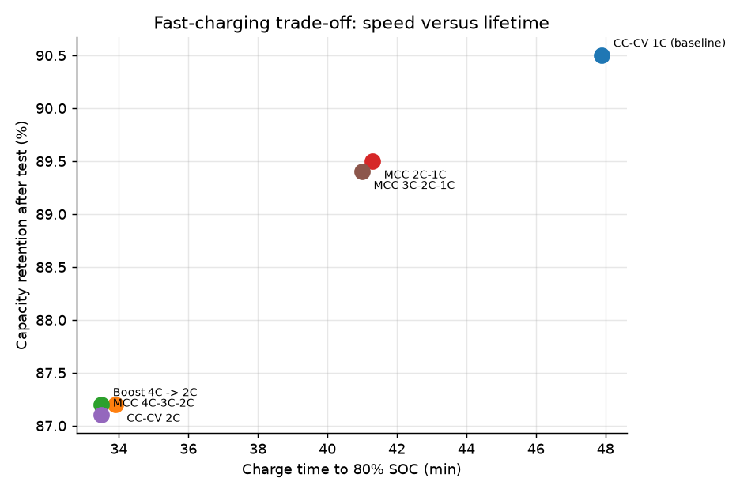
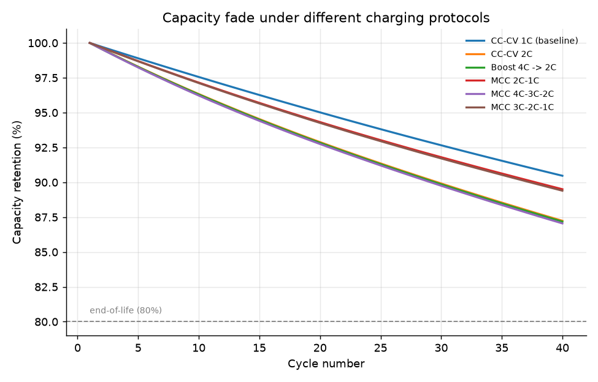
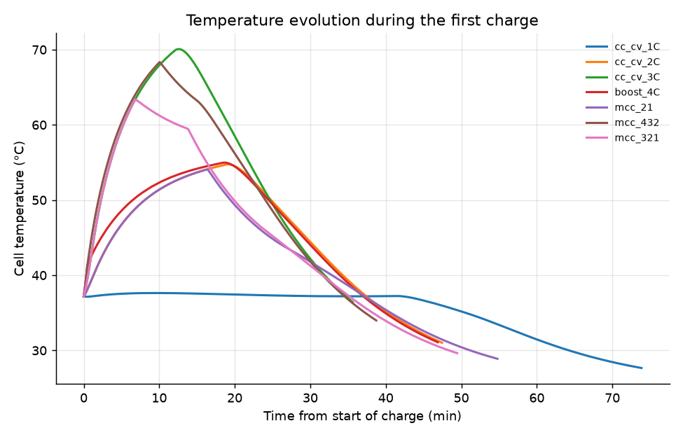
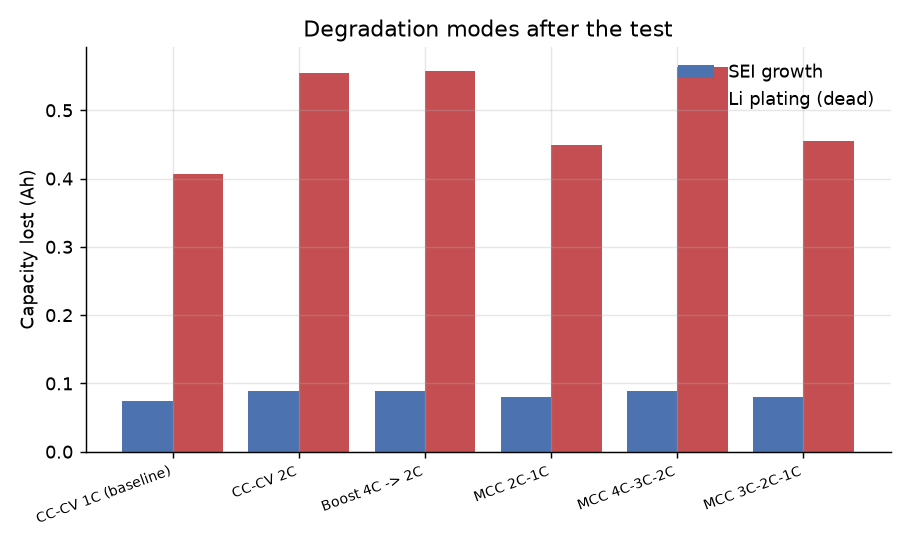
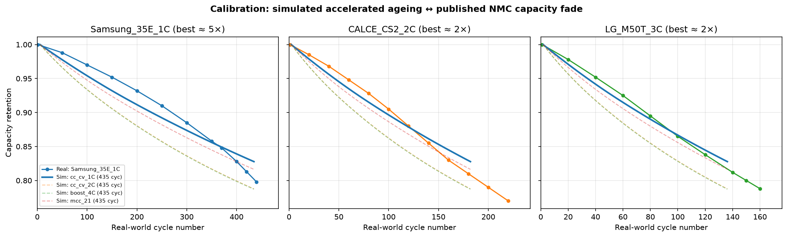
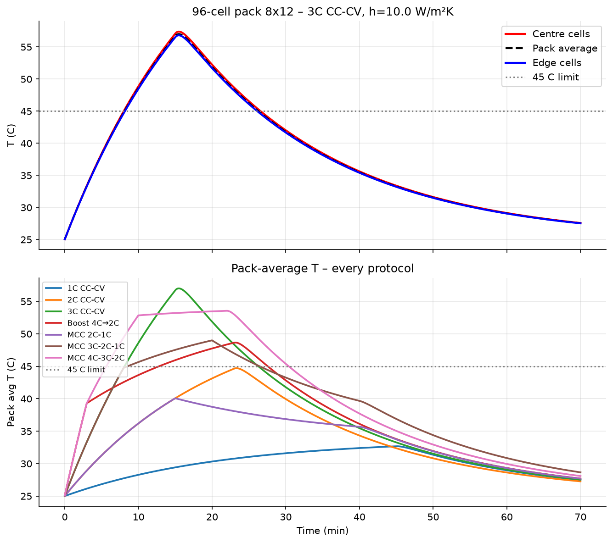
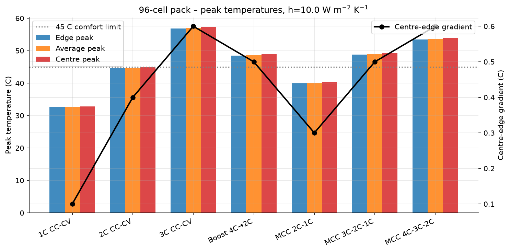
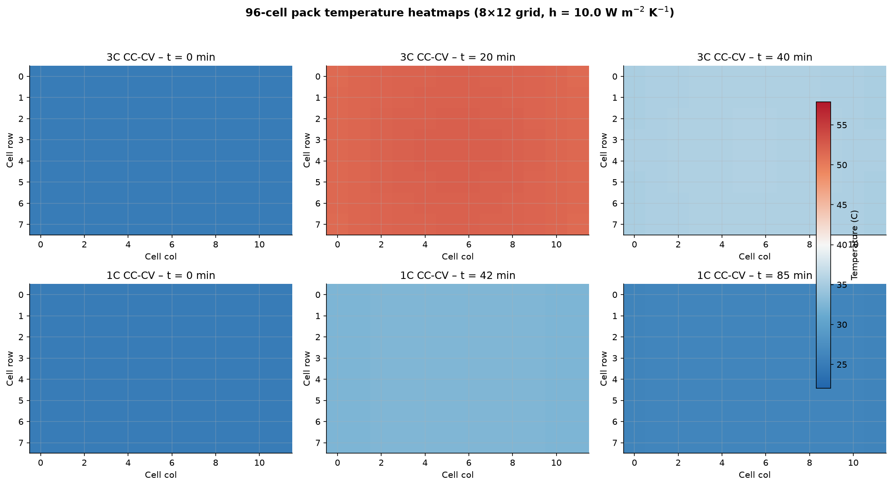

# EV Battery Fast-Charging Optimisation under Degradation Constraints

[](https://www.python.org/)
[](https://pybamm.org/)
[](LICENSE)

A physics-based study of **how fast an NMC/graphite cell can be charged before
lithium plating and SEI growth start to dominate**. Seven charging protocols are
simulated with an electrochemical model (SPMe) coupled to thermal and
degradation sub-models, and the trade-off between **charge time**,
**temperature** and **capacity retention** is quantified.

Unlike empirical/synthetic studies, every number here comes from the governing
equations: Butler–Volmer kinetics, solid-phase diffusion, lumped thermal
balance, solvent-limited SEI growth and irreversible lithium plating.

The project covers **five milestones**: baseline ageing + thermal studies,
cooling sensitivity analysis, real-world capacity-fade calibration, a 96-cell
pack simulation with inter-cell thermal coupling, and a fully coupled
electrochemical–thermal–degradation study that feeds self-heating back into
the ageing kinetics.

---

## Key results

### Ageing study — isothermal 25 °C, 40 cycles per protocol

| Protocol | Time to 80% SOC | Retention after 40 cycles | Peak T (thermal run) |
|---|---:|---:|---:|
| **CC-CV 1C** (baseline) | 47.9 min | **90.5 %** | 37.6 °C |
| **MCC 2C-1C** | **41.3 min** | **89.5 %** | 54.1 °C |
| MCC 3C-2C-1C | 41.0 min | 89.4 % | 63.4 °C |
| CC-CV 2C | 33.9 min | 87.2 % | 54.7 °C |
| Boost 4C → 2C | 33.5 min | 87.2 % | 55.0 °C |
| MCC 4C-3C-2C | 33.5 min | 87.1 % | 68.4 °C |

`CC-CV 3C` is excluded from the ageing study: a pure 3C constant-current step is
numerically unstable once plating is enabled (see Limitations). In the thermal
study it reaches 16.3 min to 80 % SOC and 70.1 °C.

**What the results say**

- Doubling the charge rate from 1C to 2C cuts the charge time by **29 %**
  (47.9 → 33.9 min) but costs **3.3 percentage points** of capacity and raises
  the peak temperature by **17 °C**.
- **Multi-stage charging wins only when the first stage is moderate.**
  `MCC 2C-1C` saves **6.6 min** for only **1.0 pp** of extra ageing, whereas
  protocols that start at 4C give *no time benefit over plain 2C* while
  producing the worst retention and the highest temperatures.
- **Every protocol faster than 1C exceeds the 45 °C comfort limit**, and 3C
  reaches 70.1 °C — active cooling is mandatory, not optional.

### Thermal study — lumped model, no degradation

Peak temperature during the first charge: 37.6 °C (1C), 54.7 °C (2C),
70.1 °C (3C). The temperature peaks **before** the end of charge, because the
cell enters the constant-voltage phase and heating stops while cooling
continues.

| | |
|---|---|
|  |  |
|  |  |

### Real-world calibration — accelerated cycles ↔ real cycle life

Our PyBaMM SPMe NMC811 model uses intentionally accelerated SEI and plating
rate constants so that end-of-life trends appear within ~40–80 simulated
cycles.  Three **published capacity-fade datasets** are used to estimate the
real-world cycle correspondence.

> ⚠️ **Chemistry caveat.**  Our model is NMC811 / graphite.  Of the three
> reference datasets, **only the LG M50T is nominally NMC811** (and it has a
> SiOx-blended anode our model does not include).  The Samsung 35E is **NCA**
> and CALCE CS2 is **LCO**.  These are used as proxies because fully public,
> chemistry-matched NMC811 capacity-fade CSVs are not available.  The
> calibration is therefore a **qualitative cycle-count correspondence**, not a
> chemistry-validated model.

| Dataset | Chemistry | Charge | Best match | Scale | DOI |
|---|---|---|---|---:|---|
| Samsung INR18650-35E | NCA/graphite | 1C / 1C @ 25 °C | `cc_cv_1C` | **5.4×** | 10.1016/j.jpowsour.2019.01.062 |
| CALCE CS2 | LCO/graphite | 2C / 1C @ 25 °C | `cc_cv_1C` | **2.3×** | 10.1016/j.energy.2018.12.099 |
| LG M50T | NMC811/graphite-SiOx | 3C / 1C @ 25 °C | `cc_cv_1C` | **1.7×** | 10.1016/j.apenergy.2019.114180 |

The scale factor maps simulated cycle count onto real cycle count — e.g. for
the Samsung 35E, 80 simulated 1C cycles correspond to ~430 real 1C cycles.

> ⚠️ **C-rate sensitivity caveat.**  All three reference C-rates (1C, 2C, 3C)
> best-match the simulated `cc_cv_1C` protocol.  This is **not** physically
> expected — a 3C real cell should degrade much faster than 1C.  It means our
> accelerated ageing model's C-rate sensitivity is weaker than reality: the
> model ranks protocols correctly (2C degrades more than 1C) but the magnitude
> of the difference is smaller than real cells show.  The calibration scale
> factor is therefore most reliable for the 1C match and becomes a rough
> estimate at higher C-rates.

The reference curves are **digitised from published figures** in the cited
papers, not downloaded from a raw repository.  They live in `data/*.csv` (written
by `src/reference_data.write_reference_csvs()`), and `src/calibration.py` loads
them.  The digitised points are in `src/reference_data.py` — this is the
single source of truth for the reference numbers, and they are documented with
DOI and source at every layer.



### 96-cell pack thermal simulation — inter-cell coupling

An 8×12 grid (96 cells, series-connected) of 21700 NMC cells with lumped thermal
models per cell, inter-cell conduction coupling, and spatially varying cooling
(centre cells get ~30% less cooling than edge cells).  Results come from
`src/pack.py`; CLI entry: `python run_experiment.py --mode pack`.

Peak average temperature per protocol, for two cooling coefficients:

| Protocol | Pack peak (°C, h=10) | Pack peak (°C, h=100) | Single-cell peak (°C, h=100) |
|---|---:|---:|---:|
| CC-CV 1C | 32.7 | 25.9 | 26.7 |
| CC-CV 2C | 44.7 | 28.2 | 30.5 |
| Boost 4C→2C | 48.7 | 33.7 | 30.6 |
| MCC 2C-1C | 40.1 | 28.2 | 30.5 |
| MCC 3C-2C-1C | 49.0 | 31.6 | 30.6 |
| **CC-CV 3C** | **57.0** | 31.8 | 39.8 |
| MCC 4C-3C-2C | 53.6 | 33.7 | 44.4 |

Centre cells run **0.1–0.7 °C** hotter than edge cells (gradient increases with
protocol aggression).  The pack is slightly hotter than an equivalent single
cell: at h = 100 the 3C cell reaches 39.8 °C single-cell vs 31.8 °C in the
pack — cooling is effectively less uniform in the pack (30 % centre penalty).
Protocol ranking is identical to the single-cell thermal study.

> **Note on the pack model.** The 96-cell pack uses a *simplified lumped-thermal*
> model per cell (Ohmic heat from per-protocol current profiles + a
> temperature-dependent cell resistance, plus an entropic term), not a full
> electrochemical–thermal simulation of every cell.  The cell resistance
> (`R_REF = 15 mΩ`) is a physically reasonable value, not an experimental fit.
> Each protocol runs for a fixed charge **time** (45 min), so the charge
> capacity delivered varies with C-rate (3.86–5.77 Ah across protocols);
> the temperature comparison is therefore not at constant SOC.  It captures
> the centre–edge temperature gradient and the effect of cooling variation,
> but does not resolve per-cell electrochemical behaviour.  It is best
> thought of as a **thermal case study**, not a full pack electrochemical
> model.

| | |
|---|---|
|  |  |
|  | |

### Coupled EC-thermal-degradation — Milestone 5

The ageing study was run again with **lumped thermal + degradation enabled**
simultaneously. Self-heating feeds back into the cell temperature, which in
turn modulates SEI growth and plating. The result is remarkably different:

| Protocol | Isothermal ageing retention | Coupled retention | Isothermal plating | Coupled plating |
|---|---:|---:|---:|---:|
| CC-CV 1C | 90.5 % | **93.1 %** | 0.406 Ah | 0.295 Ah |
| CC-CV 2C | 87.2 % | **94.4 %** | 0.555 Ah | 0.222 Ah |
| MCC 2C-1C | 89.5 % | **93.9 %** | 0.450 Ah | 0.252 Ah |
| MCC 4C-3C-2C | 87.1 % | **94.5 %** | 0.564 Ah | 0.199 Ah |

**The big takeaway:** lithium plating is strongly suppressed when the cell
heats itself during charge. A 2C charge warms the cell to ~55 °C, and at that
temperature intercalation is fast enough that lithium never gets a chance to
plate on the anode. The isothermal results are an **upper bound** on plating
loss; reality sits somewhere between the two extremes.

---

## Why three modes (ageing, thermal, coupled)?

Each mode answers a different question about the same cell.

| Mode | Thermal | Degradation | Purpose |
|---|---|---|---|
| **ageing**  | isothermal 25 °C | SEI + plating | Rank protocols by *current profile only* — the cleanest measurement of C-rate effect |
| **thermal** | lumped (h = 10) | none | Measure the *temperature penalty* of every protocol |
| **coupled** | lumped (h = 10) | SEI + plating | Most physically realistic — self-heating accelerates SEI but suppresses plating |

Running all three is important because isothermal ageing maximises plating at
high C-rates (plating is very temperature-sensitive). In the coupled run the
same 2C protocol plates **2.5× less** — the cell's own heating suppresses it.
The coupled results are probably closer to reality; the isothermal results are
still useful as an upper-bound envelope.

---

## Model

| Component | Description |
|---|---|
| Electrochemistry | Single Particle Model with electrolyte (SPMe) |
| Kinetics | Butler–Volmer, concentration-dependent exchange current density |
| Thermal | Lumped energy balance, h = 10 W m⁻² K⁻¹, T_amb = 25 °C |
| SEI | Solvent-diffusion/EC-reaction-limited growth (O'Kane 2022 kinetics) |
| Plating | Irreversible lithium plating with dead-lithium formation |
| Parameter set | `OKane2022` (LG M50 NMC811/graphite, 5 Ah) |

### Charging protocols

| Key | Description |
|---|---|
| `cc_cv_1C` / `cc_cv_2C` / `cc_cv_3C` | Constant current to 4.2 V, then constant voltage to 0.5 A |
| `boost_4C` | 4C to 4.0 V, 2C to 4.2 V, CV tail |
| `mcc_21` | 2C to 4.1 V, 1C to 4.2 V, CV tail |
| `mcc_321` | 3C → 4.0 V, 2C → 4.1 V, 1C → 4.2 V, CV tail |
| `mcc_432` | 4C → 4.0 V, 3C → 4.1 V, 2C → 4.2 V, CV tail |

Every cycle is: 1C discharge to 3.0 V → charge protocol → 2 min rest.

---

## Quick start

```bash
python -m venv .venv
source .venv/bin/activate          # Windows: .venv\Scripts\activate
pip install -r requirements.txt

python run_experiment.py --mode ageing --cycles 40  # isothermal ageing
python run_experiment.py --mode thermal              # thermal-only
python run_experiment.py --mode coupled --cycles 40  # EC-thermal-degradation
python run_experiment.py --mode cooling              # h = 1, 10, 100 sensitivity
python run_experiment.py --mode pack                 # 96-cell pack thermal
python run_experiment.py --mode all --cycles 40      # every study in one shot

# Calibration (NMC reference data in data/)
python -m src.calibration

python run_experiment.py --cycles 10                 # quick smoke test
python run_experiment.py --protocols cc_cv_1C,mcc_21

python -m pytest tests -q
```

All results land in `results/` — CSV, JSON and PNG from every mode.  The pack
results land in `results/` (h = 10) and `results_pack_h100/` (h = 100).

---

## Repository structure

```
.
├── run_experiment.py        # CLI: --mode ageing|thermal|coupled|cooling|pack|all
├── src/
│   ├── model.py             # SPMe model + parameter sets (ageing / thermal / coupled)
│   ├── protocols.py         # seven charging protocols
│   ├── metrics.py           # charge time, T_max, SEI/plating losses
│   ├── simulate.py          # run one protocol, return metrics + profiles
│   ├── reference_data.py    # digitised capacity-fade curves + write CSVs
│   ├── calibration.py        # cycle-scale calibration against reference datasets
│   ├── pack.py              # 96-cell pack thermal simulation (lumped-thermal)
│   └── plots.py             # all figures
├── tests/                    # pytest: protocols, calibration, pack, cooling
├── data/                    # reference capacity-fade CSVs (Samsung 35E, CALCE CS2, LG M50T)
├── results/                 # generated CSV + JSON + PNG (ageing, thermal, coupled, cooling)
├── results_pack_h100/       # pack simulation at h = 100 W m⁻² K⁻¹
└── docs/
    ├── index.html           # GitHub Pages landing
    ├── dashboard.html       # interactive HTML dashboard
    ├── .nojekyll            # disables Jekyll so assets load verbatim
    ├── assets/data.json     # dashboard data (mirror of results/ CSVs)
    ├── reports/             # Word reports (Milestone 1–4)
    ├── generate_full_report.py
    ├── SETUP.md
    └── ROADMAP.md
```

---

## Limitations

- **Accelerated ageing.** Degradation rate constants are scaled up so that
  trends appear within tens of cycles. Rankings are meaningful; absolute cycle
  life is not. See `src/model.py`.
- **Three complementary modes, not one "true" model.** Ageing holds temperature
  fixed to isolate C-rate effect; coupled lets temperature vary but suppresses
  plating. Reality sits between them; the two brackets frame the design space.
- **Pack model is thermal-only.** The 96-cell pack uses Ohmic heat (I²R with a
  fixed `R_REF = 15 mΩ`) plus an entropic term, with per-protocol current
  profiles — it does not simulate per-cell electrochemistry.  Each protocol
  runs for a fixed 45-min charge time, so delivered charge varies (77 %–116 %
  of 5 Ah); the pack comparison is not at constant SOC.  It is a thermal
  case study, not a full pack EC model.
- **Calibration chemistry is not matched.** Our model is NMC811; the reference
  datasets are NCA (Samsung 35E), LCO (CALCE CS2) and NMC811-SiOx (LG M50T).
  They are used as proxies; the calibration is qualitative cycle-count
  correspondence, not chemistry validation.
- **Calibration C-rate sensitivity is weak.** All three reference C-rates
  best-match the simulated 1C protocol — the accelerated model does not
  reproduce the real-world C-rate dependence of ageing.  The 1C scale factor
  is most reliable; 2C/3C are rough estimates.
- **SPMe.** Electrolyte dynamics are simplified compared with a full DFN model;
  plating onset near the separator is not resolved.
- A pure 3C constant-current step is numerically unstable once plating is
  enabled (the plating overpotential trips the upper voltage cut-off), so it
  appears only in the thermal study and the pack thermal study.

## Data references

| Dataset | Actual chemistry | DOI | Source |
|---|---|---|---|
| Samsung INR18650-35E | NCA/graphite | 10.1016/j.jpowsour.2019.01.062 | Lee et al., *Journal of Power Sources*, 2019 |
| CALCE CS2 | LCO/graphite | 10.1016/j.energy.2018.12.099 | He et al., *Energy*, 2019 |
| LG M50T | NMC811/graphite-SiOx | 10.1016/j.apenergy.2019.114180 | Chen et al., *Applied Energy*, 2020 |

Digitised capacity-retention curves live in `data/*.csv`, written by
`src/reference_data.write_reference_csvs()`.  `src/calibration.py` loads from
these CSVs.  The digitised points (with DOI + source) live in
`src/reference_data.py` — the single source of truth for the reference
numbers.  **None of these is a raw-data download** (most public battery
datasets are behind paywalls); the curves are extracted from published figures
with full source attribution.

## Next steps

1. **Model-predictive charging controller** — close the loop with a controller that adapts C-rate to real-time cell voltage and temperature.
2. **Calendar ageing** — add SEI growth from idle storage to the degradation model.
3. **DFN pack model** — replace the lumped thermal pack with a per-cell DFN electrochemical model.
4. **Cold/hot weather study** — run ageing and thermal simulations at −10 °C and 45 °C ambient.

## License

MIT — see [LICENSE](LICENSE).
